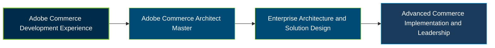

# Adobe Commerce Architect Master Certification Exam Guide

A dedicated, comprehensive study guide and architectural reference repository for candidates preparing for the **Adobe Commerce Architect Master Certification Exam (AD0-E722)**.

---

## Exam Overview

The Adobe Commerce Architect Master certification validates advanced expertise in designing, reviewing, configuring, and deploying scalable Adobe Commerce solutions that address complex business and technical requirements.

- **Exam Format**: Online proctored certification exam.
- **Target Audience**: Lead Adobe Commerce Architects, Technical Architects, Solution Architects, Technical Leads, and Senior Developers.
- **Prerequisites**: Adobe recommends 3–5 years of experience leading Commerce development projects, including solution design, integration, implementation, and technical leadership.

---

## Core Exam Domains & Knowledge Areas

### 1. Design

- Design optimal Adobe Commerce solutions aligned with business requirements.
- Develop logical and technical solution flows and customize Commerce features.
- Integrate Adobe Commerce with external systems and services; troubleshoot design flows.

### 2. Review

- Review and refactor existing Adobe Commerce customizations.
- Apply Commerce testing frameworks throughout the development workflow.
- Optimize performance and scalability, troubleshoot root causes, and enforce coding standards.

### 3. Configure and Deploy

- Configure Adobe Commerce and establish an optimized project setup.
- Configure Adobe Commerce Cloud environments and services.
- Oversee deployment processes and troubleshoot infrastructure and configuration issues.

---

## Certification Path

## Recommended Practice & Study Resources

To prepare effectively, combine Adobe's official exam preparation materials with hands-on architecture, implementation, and deployment experience:

- **CertsGate**: Explore [Adobe AD0-E722 preparation resources](https://certsgate.com/exams/adobe/ad0-e722) for supplementary practice questions and study materials.
- **Adobe Commerce Developer Documentation**: Use the [Adobe Commerce developer documentation](https://developer.adobe.com/commerce/) to study architecture, integrations, customization, performance, and deployment concepts.
